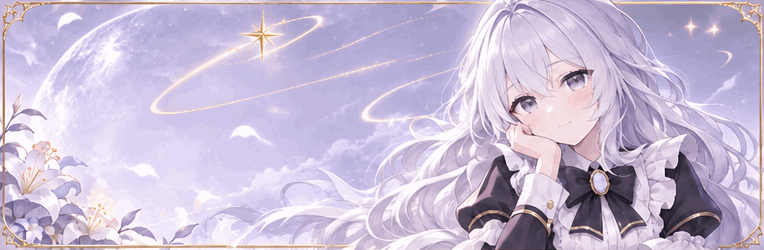

<!-- Luchi Profile v2.0 · Designed for GitHub README rendering -->

  

 

## ✦ About Me

I'm an AI engineer working at the intersection of **large language models, agentic systems, and practical software engineering**. I enjoy turning research questions into working prototypes and reliable systems.

- 🔬 **Research:** autonomous penetration testing, multi-agent orchestration, LLM adaptation, and long-term conversational memory.
- 🛠️ **Engineering:** Python, C#, TypeScript, React / Next.js, Docker, and application modernization.
- 🌱 **Exploring:** better AI companions, retrieval, model evaluation, and developer experience.

## ✦ Selected Work

| Project | Focus | Availability |
|:--|:--|:--|
| **SynapsePT** | Coordinated multi-agent autonomous penetration testing framework | Research project |
| **Maid Core** | Personal AI companion with persona, cross-session memory, and a future Live2D interface | Personal project |
| [**management_platform**](https://github.com/hakuei0115/management_platform) | Application engineering and platform development | Public repository |
| [**freyja_project**](https://github.com/hakuei0115/freyja_project) | Front-end / web project | Public repository |

> Some research and personal projects are not publicly hosted in this GitHub account. The project names above are descriptions, not links to nonexistent repositories.

## ✦ Toolbox

        

## ✦ Meet Luchi

**Luchi (露希)** is my original AI maid companion and the visual mascot of **Maid Core**. Her gentle silver-gray eyes and silver-white wavy hair represent the softer side of a deeply technical project: how can an AI companion remain consistent, remember meaningful interactions, and grow through shared experiences?

Maid Core explores that question through **persona design, long-term memory, LLM integration, and future voice / Live2D experiences**.

  

 

---

*Thanks for visiting — see you around! ✨*

Profile visual palette: silver-white · cool lavender · champagne gold · charcoal violet

